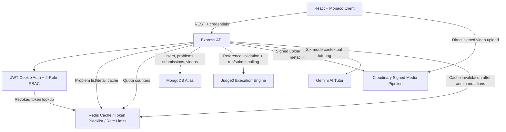

# CodeArena — Distributed Online Code Execution & AI Coaching Engine

CodeArena is a production-oriented online judge and AI coaching platform. It combines a React/Monaco coding workspace with an Express API, MongoDB Atlas persistence, Redis-backed security and performance controls, Judge0 execution, signed Cloudinary media uploads, and a context-aware Gemini tutor.

The system is intentionally designed to demonstrate the engineering concerns expected in a distributed backend interview: stateless authentication, role-based authorization, external execution orchestration, quota protection, cache invalidation, asynchronous polling, and operational latency visibility.

## System Architecture



## Core Engineering Highlights

### Stateless cookie-based authentication and authorization

- JWTs are issued after registration, login, and admin registration.
- The browser sends the JWT through an HTTP cookie; bearer authorization is also accepted by the user middleware.
- `user` and `admin` roles are enforced by separate authentication middleware.
- Logout adds the token to Redis with an expiry matching the JWT expiry. This provides immediate token revocation without server-side sessions.
- MongoDB remains the source of truth for user records and role state.

### Redis performance and abuse controls

- Problem list and individual problem detail reads use a cache-aside pattern with a 10-minute TTL.
- Successful problem creation, update, and deletion invalidate affected problem keys.
- Code execution and submission are limited to 10 requests per minute per user.
- Gemini tutor requests are limited to 15 requests per minute per user.
- Response headers expose cache and rate-limit state for demonstration and troubleshooting.
- A global response-time middleware logs the method, resolved route, status, and elapsed milliseconds.

### Judge0 validation and execution pipeline

- Admin-created and admin-updated problems validate every reference solution before persistence.
- The API submits visible test cases to Judge0, polls each token until completion, and rejects invalid reference solutions.
- Runtime user submissions execute against hidden test cases and are persisted with status, pass counts, runtime, memory, and error details.
- The supported reference/user execution languages are C++, Java, and JavaScript in the primary product flow; the Judge0 language utility also contains mappings for C and Python.

### Context-aware six-mode Gemini tutor

The AI Tutor receives the current problem context, examples, starter code, and the user's message. Its system prompt supports six coaching modes:

1. Hint Provider
2. Code Reviewer
3. Solution Guide
4. Complexity Analyzer
5. Approach Suggester
6. Test Case Helper

The tutor is constrained to the current data-structures-and-algorithms problem rather than acting as a general-purpose chatbot.

### Signed Cloudinary admin media pipeline

- Admins request a signed upload payload from the API.
- The client uploads video directly to Cloudinary, keeping large media off the API process.
- The API verifies the uploaded resource, persists metadata in MongoDB, and derives a thumbnail URL.
- Admin deletion removes both the MongoDB metadata and the Cloudinary video asset.

## Frontend Experience

The React client provides a responsive problem dashboard, authentication screens, an admin workspace, and a split-pane Monaco coding workspace.

### Dashboard and daily challenge

- Dashboard totals and topic progress are calculated from the authenticated user's live problem and solved-problem API responses; problem data is not hardcoded in the client.
- The daily challenge is selected deterministically from the currently unsolved problems using the browser's local calendar day and the number of unsolved problems. This keeps the selection stable for a user during the day without adding a backend endpoint or database field.
- If all available problems are solved, the dashboard links to the first available problem as a practice option.
- The problem library supports title search, difficulty/topic/status filters, title/difficulty sorting, pagination, and bookmarks saved in browser `localStorage`.

### Theme preference

- Light and dark themes are available from the application header and coding workspace.
- The selected theme is saved in `localStorage`, restored on refresh, and used to select the matching Monaco Editor theme.
- An early document script applies the stored theme before the React application renders to reduce theme flashing.

### Run and Submit behavior

- **Run** evaluates only the problem's visible test cases and displays each case's input, expected output, actual output, status, runtime, and memory where available. Running code does not mark a problem solved.
- **Submit** evaluates against the hidden judge suite and saves the submission. A problem is marked solved only when the backend accepts the submission.
- Accepted submissions trigger a short, non-blocking celebration in the result panel. It does not run for Run results or failed submissions, and respects the operating system's reduced-motion preference.
- Submission responses include a failure status and compiler/runtime message when available. Hidden test inputs and outputs remain private.
- Run and Submit use an indeterminate progress indicator because the execution API does not report live progress percentages.

## Repository Layout

```text
.
├── Backend/
│   ├── src/
│   │   ├── config/          # MongoDB and Redis clients
│   │   ├── Controllers/     # Auth, problems, submissions, AI, media
│   │   ├── middleware/      # JWT/RBAC, cache, rate limit, timing
│   │   ├── modules/         # User, problem, submission, solution video schemas
│   │   ├── routes/          # Five Express route modules
│   │   └── utils/           # Judge0 language mapping and polling
│   ├── .env.example
│   └── package.json
├── Frontend/
│   ├── src/
│   │   ├── components/      # Shared theme/header, execution results, admin, AI, history
│   │   ├── pages/           # Auth, home, problem, and admin pages
│   │   └── utils/           # Axios API client
│   ├── .env.example
│   └── package.json
└── README.md
```

## Data Model

| Model | Responsibility | Key relationships |
|---|---|---|
| `user` | Identity, password hash, role, solved problems | References solved `problem` documents |
| `problem` | Problem statement, difficulty, tests, starter code, reference solutions | References its creating `user` |
| `submission` | User code execution result and resource metrics | References `user` and `problem` |
| `solutionVideo` | Verified Cloudinary editorial metadata | References `problem` and uploading `user` |

## API Reference

All protected routes require an authenticated cookie or `Authorization: Bearer <token>`. Admin routes additionally require the `admin` role.

### Auth

| Method | Endpoint | Access | Purpose |
|---|---|---|---|
| `POST` | `/user/register` | Public | Register a user and issue a JWT |
| `POST` | `/user/login` | Public | Authenticate and issue a JWT |
| `POST` | `/user/logout` | User | Revoke the current JWT in Redis |
| `GET` | `/user/check` | User | Return the authenticated profile summary |
| `POST` | `/user/admin/register` | Admin | Register an administrator |
| `DELETE` | `/user/deleteProfile` | User | Delete the authenticated user profile |

### Problems

| Method | Endpoint | Access | Purpose |
|---|---|---|---|
| `GET` | `/problem/getAllProblem` | User | List problem summaries; Redis cached |
| `GET` | `/problem/problemById/:id` | User | Fetch problem details and optional editorial video; Redis cached |
| `GET` | `/problem/problemSolvedByUser` | User | List problems solved by the current user |
| `GET` | `/problem/submittedProblem/:id` | User | Fetch the current user's submissions for a problem |
| `POST` | `/problem/create` | Admin | Validate reference solutions through Judge0, then create a problem |
| `PUT` | `/problem/update/:id` | Admin | Validate updated reference solutions and update a problem |
| `DELETE` | `/problem/delete/:id` | Admin | Delete a problem and invalidate related caches |

### Submissions

| Method | Endpoint | Access | Purpose |
|---|---|---|---|
| `POST` | `/submission/run/:id` | User | Execute code against visible test cases and return per-case output and resource metrics |
| `POST` | `/submission/submit/:id` | User | Execute against hidden test cases, persist the result, and return acceptance plus failure status metadata |

Both endpoints are protected by the per-user Judge0 rate limit.

### AI Tutor

| Method | Endpoint | Access | Purpose |
|---|---|---|---|
| `POST` | `/ai/chat` | User | Ask the contextual six-mode Gemini DSA tutor |

The endpoint is protected by the per-user Gemini rate limit.

### Admin media

| Method | Endpoint | Access | Purpose |
|---|---|---|---|
| `GET` | `/video/create/:problemId` | Admin | Generate signed Cloudinary upload parameters |
| `POST` | `/video/save` | Admin | Verify a Cloudinary upload and save video metadata |
| `DELETE` | `/video/delete/:problemId` | Admin | Delete the editorial video from MongoDB and Cloudinary |

## Local Setup

### Prerequisites

- Node.js 18+ and npm
- A MongoDB Atlas cluster or local MongoDB instance
- Redis 6+ (local Redis or a managed Redis provider)
- A Judge0-compatible endpoint
- A Google Gemini API key
- A Cloudinary account with video uploads enabled

### 1. Clone and install dependencies

```bash
git clone <your-repository-url>
cd "LeetCode Project"

cd Backend
npm install

cd ../Frontend
npm install
```

### 2. Configure backend environment variables

```bash
cd Backend
cp .env.example .env
```

Set real local/deployment values in `Backend/.env`:

- `DB_CONNECTION_STRING` for MongoDB Atlas.
- `JWT_SECRET` to a long random signing key.
- `REDIS_HOST`, `REDIS_PORT`, `REDIS_USERNAME`, and `REDIS_PASS`.
- `GEMINI_KEY` for the AI Tutor.
- `CLOUDINARY_CLOUD_NAME`, `CLOUDINARY_API_KEY`, and `CLOUDINARY_API_SECRET`.
- `JUDGE0_URL` if using a self-hosted or managed Judge0 endpoint.
- `FRONTEND_ORIGIN` for the browser origin allowed by CORS.

Never commit `.env` files or real secrets.

### 3. Start Redis

For a local Redis installation:

```bash
redis-server
```

Verify connectivity:

```bash
redis-cli ping
# PONG
```

For managed Redis, use its host, port, username, and password in `Backend/.env`.

### 4. Configure the frontend

```bash
cd ../Frontend
cp .env.example .env
```

Set `VITE_API_BASE_URL` to the backend origin, for example `http://localhost:3000`. The Axios client sends credentials so the JWT cookie is included in API requests.

### 5. Start the backend

```bash
cd ../Backend
node src/index.js
```

The API listens on `PORT` (default `3000`) after MongoDB and Redis connect successfully.

### 6. Start the frontend

In another terminal:

```bash
cd Frontend
npm run dev
```

Open the Vite URL, normally `http://localhost:5173`.

### 7. Validate the production frontend build

```bash
cd Frontend
npm run build
```

## Operational Notes

- Redis caching is scoped to problem reads and is explicitly invalidated after successful admin mutations.
- Redis token blacklist entries expire with the JWT, preventing unbounded blacklist growth.
- Rate-limit counters use user IDs rather than IP addresses because protected execution and AI routes already require authentication.
- Judge0 polling is synchronous from the API request perspective; a future scale-out path would move long-running execution jobs to a queue and worker pool.
- Cloudinary uploads are direct from the browser after the API signs the request, reducing API bandwidth and process memory pressure.
- The current response-time logger is intentionally lightweight and writes structured fields in a human-readable line for interview demonstrations.

## Security Baseline

- Keep all API keys and database credentials in environment variables.
- Use HTTPS in non-local environments so JWT cookies and API traffic are encrypted.
- Restrict `FRONTEND_ORIGIN` to the deployed client origin.
- Use a managed Redis ACL/user with the minimum required permissions.
- Rotate JWT, Gemini, Cloudinary, MongoDB, and Redis credentials through the deployment secret manager.
